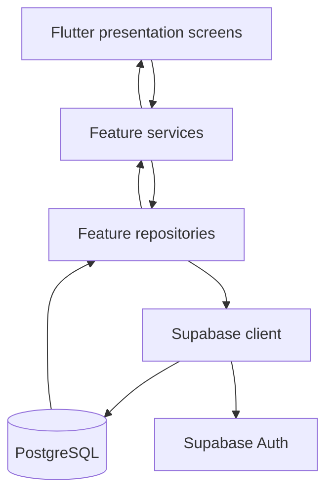

# ShopFlow architecture

## 1. Overview

ShopFlow is a Flutter client backed by Supabase Auth and PostgreSQL. The application is organised by business feature. Within most features, presentation code is separated from business rules and data access.

The intended request flow is:

PostgreSQL is the authoritative source for shop data. The client may validate input for a better user experience, but the database must enforce ownership, constraints, stock availability and transaction correctness.

## 2. Application bootstrap

`lib/main.dart` is the entry point. It:

1. Initializes Flutter bindings.
2. Loads `.env` with `flutter_dotenv`.
3. Reads `SUPABASE_URL` and `SUPABASE_PUBLISHABLE_KEY`.
4. Stops startup with a `StateError` if either setting is missing.
5. Initializes Supabase.
6. Launches `ShopFlowApp`.

`lib/app.dart` configures the `MaterialApp`, theme and top-level application wiring. Authentication and shop verification are handled through `AuthGate` before the authenticated shell is shown.

## 3. Authentication and shop access

The authentication feature contains:

- `presentation/` — sign-in, registration, forgot-password, password-update and `AuthGate` screens/flow.
- `services/auth_service.dart` — input validation and application-facing authentication operations.
- `data/auth_repository.dart` — Supabase Auth calls and profile/shop lookups.

`AuthGate` listens to Supabase authentication events. When a user is authenticated, it checks whether the user owns a shop. It routes the user to shop setup when no shop exists, or to the authenticated application when a shop is available. Password recovery must take precedence over the normal shop flow so the user can set a new password before navigating into the application.

## 4. The authenticated shell

`ShopFlowShell` hosts the main application workspaces. The `ShopFlowDestination` enum defines the destination order used by the shell's `IndexedStack`.

The Command Centre is presented as a drawer. Selecting a destination updates the selected index while retaining each screen in the stack. When adding or removing a destination, keep the enum and the screen list in `ShopFlowShell` aligned.

## 5. Feature layers

A typical feature is structured as follows:

| Layer | Responsibility | Examples |
|---|---|---|
| Presentation | Screens, forms, local UI state and user feedback | `products_screen.dart`, `pos_screen.dart` |
| Service | Validation, use-case coordination and domain-facing errors | `product_service.dart`, `pos_service.dart` |
| Repository/data | Supabase queries and database operation calls | `product_repository.dart`, `pos_repository.dart` |
| Models | Typed application representations of records and operations | `product.dart`, `pos_models.dart` |

The presentation layer should not become the place where SQL table names, authorization decisions or transaction rules are implemented. The repository handles communication with Supabase. The service provides an application-facing operation and validates inputs before calling the repository.

## 6. Cross-feature refresh notifications

`lib/shared/state/shopflow_events.dart` provides a shared data revision notification. Feature screens listen for successful changes elsewhere and reload the data they display.

For example, receiving stock or completing a sale should cause relevant product, inventory, POS and dashboard screens to refresh. A notification is a request to reload; it is not a replacement for reading authoritative data from Supabase.

## 7. Database-backed operations

Some operations should be executed atomically by PostgreSQL rather than as several independent client requests.

- Stock receiving calls `receive_stock`.
- Stock adjustment calls `adjust_stock`.
- POS checkout calls `complete_sale`.

The checked-in `SHOPFLOW_DATABASE.sql` defines `receive_stock`, but does not currently define `adjust_stock` or `complete_sale`. Those application/database contracts must be completed and tested before describing stock adjustment and checkout as fully deployable on a fresh database.

## 8. Money, quantity and business time

### Money

Money is represented in integer minor units in Dart models and PostgreSQL. There are 100 minor units in SLE 1.00. For example, SLE 25.50 is represented as `2550`. Use the shared SLE formatter/parser rather than binary floating-point values for monetary calculations.

### Quantity

Inventory quantities are represented as numeric values and can support three decimal places in the service/database design. The current POS models use integer quantities and explicitly reject fractional stock values when loading the POS stock map.

### Business time

`ShopFlowTime` stores and queries timestamps as UTC instants. Sierra Leone business time is UTC+00:00, so current business-day boundaries are calculated in UTC and displayed in the same time basis.

## 9. Offline behaviour

The current application uses Supabase for data access. Although `sqflite` appears in the package dependencies, the inspected source does not contain a completed local catalogue cache, offline write queue or safe transaction synchronization mechanism. Do not introduce offline transaction claims until those capabilities are implemented and tested.

## 10. Architectural boundaries to preserve

- Keep feature-specific UI, business logic and data access separate.
- Keep database ownership and validation rules in PostgreSQL, including RLS and trusted functions.
- Do not calculate the final authoritative checkout total only in the client.
- Use integer minor units for money.
- Use `ShopFlowTime` for business-date calculations.
- Keep cross-feature refreshes explicit and avoid tightly coupling screens to one another.
- Add tests and update documentation when a layer's contract changes.
