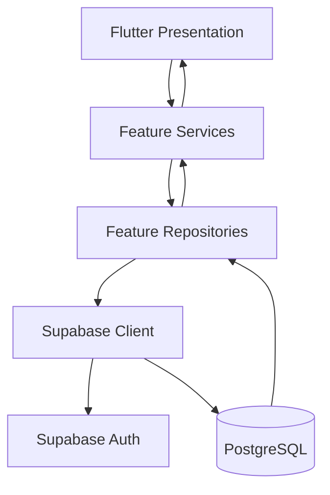
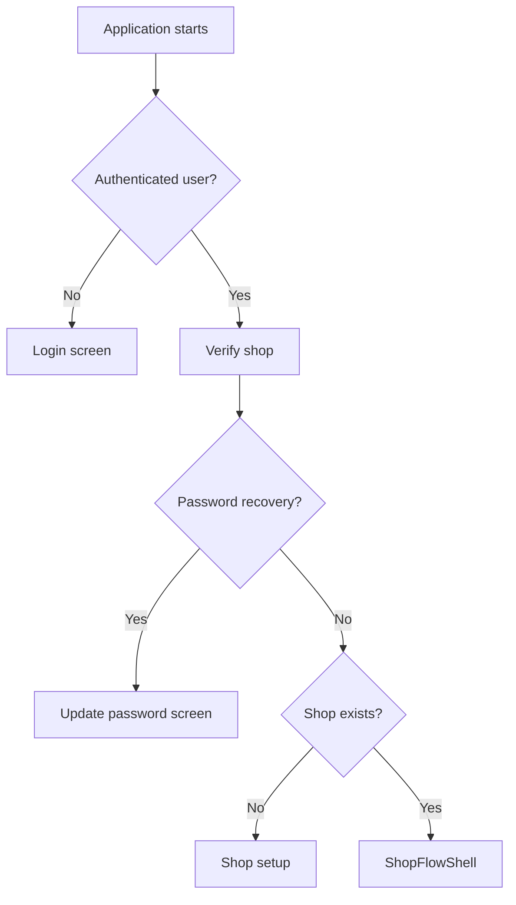

# ShopFlow Architecture

**Application:** Flutter / Dart  
**Backend:** Supabase  
**Database:** PostgreSQL  
**Architecture:** Feature-oriented, layered application  
**Status:** Active development

## 1. Overview

ShopFlow is a Flutter application backed by Supabase Auth and PostgreSQL.

The application is organised around business features. Each feature separates presentation, business logic and data access where appropriate.

The main request flow is:



**PostgreSQL is the authoritative source of application data.**

The Flutter application handles user interaction, input validation, screen state and presentation. Feature services coordinate application operations, while repositories communicate with Supabase.

Database constraints, Row Level Security and trusted database functions enforce important data and business rules.

## 2. Application Bootstrap

The application starts in `lib/main.dart`.

Its responsibilities are:

1. Initialize Flutter bindings.
2. Load the root `.env` file using `flutter_dotenv`.
3. Read `SUPABASE_URL` and `SUPABASE_PUBLISHABLE_KEY`.
4. Validate that both configuration values are present.
5. Initialize Supabase.
6. Launch `ShopFlowApp`.

If the required environment configuration is missing, application startup stops with a `StateError`.

### Application configuration

`lib/app.dart` defines `ShopFlowApp`.

It configures:

- The application title.
- The Material application and theme.
- Authentication and shop services.
- The authentication gate.
- The authenticated application shell.

The application uses `AppTheme.light` for its theme configuration.

## 3. Authentication and Shop Access

Authentication is handled by the authentication feature:

```text
features/
  authentication/
    presentation/
    services/
    data/
```

### AuthService

`auth_service.dart` provides application-facing authentication operations.

These include:

- User registration.
- Sign-in.
- Signup confirmation email requests.
- Password recovery.
- Password changes.
- Sign-out.
- Access to the current authenticated user and authentication events.

It also performs application-level input validation.

### AuthRepository

`auth_repository.dart` communicates with Supabase Auth and retrieves information about the signed-in user's shop.

It is responsible for the underlying authentication requests and related Supabase queries.

### AuthGate

`auth_gate.dart` listens to Supabase authentication events and controls which part of the application the user sees.

Its main flow is:



Password recovery receives special handling so the user can update their password before entering the normal shop workflow.

The authenticated application is displayed after the user has an active session and the shop verification flow succeeds.

## 4. Application Shell and Navigation

The authenticated workspace is managed by:

`lib/features/shell/presentation/shopflow_shell.dart`

`ShopFlowShell` provides the shared application structure.

It currently contains:

- A shared ShopFlow AppBar.
- A hamburger menu.
- The Command Centre drawer.
- The selected feature screen.
- A Home-screen shortcut to the Point of Sale.

### Command Centre

The Command Centre is implemented in `command_centre_screen.dart`.

It provides navigation to nine destinations:

1. Home.
2. Point of Sale.
3. Products.
4. Inventory.
5. Categories.
6. Stock Movements.
7. Sales History.
8. Reports.
9. Settings.

The destinations are defined by the `ShopFlowDestination` enum.

### IndexedStack

The shell uses Flutter's `IndexedStack` to display the selected destination while retaining the state of the other destination screens.

The screen list in `ShopFlowShell` must follow the same order as `ShopFlowDestination.values`.

When adding or removing a destination, update both in the same change.

The Command Centre drawer is a navigation interface, not a separate destination in the `IndexedStack`.

## 5. Feature-Oriented Structure

ShopFlow groups functionality by business feature.

The main feature areas are:

| Feature | Responsibility |
|---|---|
| Authentication | Registration, sign-in and password management. |
| Shop Setup | Creating and verifying the shop profile. |
| Home | Dashboard information and quick actions. |
| Products | Product catalogue management. |
| Categories | Product category management and assignments. |
| Inventory | Current stock and stock adjustments. |
| Stock Movements | Stock movement history. |
| POS | Cart management and checkout. |
| Sales History | Reviewing completed transactions. |
| Reports | Business summaries and reporting. |
| Settings | Shop and account settings. |
| Shell | Main application navigation and shared workspace. |

The features communicate through services and repositories rather than placing database queries directly inside screen widgets.

## 6. Responsibilities of Each Layer

A typical feature separates its responsibilities into the following parts.

| Layer | Responsibility | Example |
|---|---|---|
| Presentation | Screens, forms, user interaction and display states. | `products_screen.dart` |
| Service | Validation, business rules and workflow coordination. | `product_service.dart` |
| Data / Repository | Supabase queries, writes and RPC calls. | `product_repository.dart` |
| Models | Application representations of records and operations. | `product.dart` |

### Presentation layer

Responsible for:

- Displaying data.
- Collecting user input.
- Handling local screen state.
- Showing loading, empty, success and error states.
- Calling feature services.

Presentation widgets should not contain complex database queries or become the source of authoritative business rules.

### Service layer

Responsible for:

- Validating application inputs.
- Applying feature-level business rules.
- Coordinating repository operations.
- Returning meaningful results and errors to presentation code.

For example, `InventoryService` validates stock quantities and adjustment reasons before requesting a repository operation.

### Repository layer

Responsible for:

- Communicating with Supabase.
- Reading and writing records.
- Calling database functions through RPC.
- Mapping database responses into application data.

Repositories should not be treated as replacements for database authorization or transaction controls.

### Models

Models represent the data used by the application.

For example, the Product model contains the product ID, name, SKU, unit, prices, reorder level and active status.

Models also handle conversion between database fields and application properties where required.

## 7. Supabase Data Access

Repositories use the Supabase client initialized during application startup.

They normally obtain the client through `Supabase.instance.client`, while some repositories allow a client to be injected for testing.

Supabase operations generally use two approaches:

**Table operations**

Used for ordinary reads and permitted writes.

For example:

```dart
final response = await client
    .from('products')
    .select()
    .eq('shop_id', shopId);
```

**Database functions (RPC)**

Used for operations that require coordinated database changes.

For example:

```dart
await client.rpc(
  'receive_stock',
  params: {
    'p_shop_id': shopId,
    'p_product_id': productId,
    'p_quantity': quantity,
  },
);
```

The actual parameters must match the PostgreSQL function signature.

## 8. Database-Backed Business Operations

Certain ShopFlow operations affect multiple related records and should be handled within a PostgreSQL transaction.

The application calls:

| Operation | Repository | Database function |
|---|---|---|
| Receive stock | `InventoryRepository` | `receive_stock` |
| Adjust stock | `InventoryRepository` | `adjust_stock` |
| Complete a POS sale | `PosRepository` | `complete_sale` |

### Stock receiving

The application submits a product, quantity and optional reason.

The database validates the operation, increases the inventory balance and records a stock movement.

### Stock adjustment

The application submits the product, movement type, quantity and reason.

The database must validate ownership and stock availability, update the balance and record the movement as one transaction.

### POS checkout

The application submits product IDs, quantities and the amount paid.

The database must obtain authoritative prices, validate available quantities and payment, create the sale and sale-item records, deduct stock and record the corresponding movements within one transaction.

The application builds the receipt from the database response rather than treating its preliminary cart calculation as the final sale result.

### Current repository status

The Flutter repositories call all three functions, but the SQL file currently checked into GitHub still needs to be replaced with the consolidated version containing `adjust_stock` and `complete_sale`.

Until the SQL and deployed database have been updated and tested together, these operations should not be described as fully verified on a fresh installation.

## 9. Cross-Feature Refresh Events

`lib/shared/state/shopflow_events.dart` defines the `ShopFlowEvents` utility.

It provides a shared `ValueNotifier<int>` called `dataRevision` and a `notifyDataChanged()` method.

The intention is to let features request refreshes when successfully persisted data changes.

For example, a successful stock receipt or sale may require the inventory, product list and dashboard to reload.

The notification itself does not update the database or reload screens. The relevant feature must listen for the notification and perform its own repository read.

Verify that the affected screens are subscribed before relying on cross-feature refresh behaviour.

## 10. Money, Quantity and Business Time

### Money

ShopFlow stores monetary values as integer minor units.

There are 100 minor units in SLE 1.00.

For example:

- SLE 25.50 is stored as `2550`.
- SLE 100.00 is stored as `10000`.

The Product model uses integer values for cost and selling prices.

Use the shared formatter and parser:

`lib/shared/formatters/sle_money.dart`

Avoid floating-point values for monetary calculations.

### Quantity

Inventory quantities support up to three decimal places in the current service and database design.

The POS model currently uses integer quantities.

The POS repository rejects fractional stock instead of silently converting it into a whole number.

### Business time

`lib/shared/time/shopflow_time.dart` defines the `ShopFlowTime` utility.

It provides UTC-based methods for:

- Getting the current UTC instant.
- Calculating the beginning of today.
- Calculating the beginning of tomorrow.
- Converting timestamps to the business-time representation.

Sierra Leone uses UTC+00:00. Store timestamps as UTC instants and use consistent UTC boundaries for business-day database queries.

Use this shared utility where business-date calculations are needed. Its presence does not mean every repository or feature currently uses it.

## 11. Offline Behaviour

Supabase PostgreSQL is the authoritative data source.

The project lists packages such as `sqflite` and `connectivity_plus`, but the inspected application source does not yet contain a completed SQLite cache, offline write queue or transaction synchronization implementation.

The current architecture therefore assumes:

- Cloud access for data operations.
- Successful cloud confirmation for critical writes.
- No offline sales or inventory transactions.
- No automatic replay of pending transactions.

Do not describe the application as supporting offline transactions until that functionality is implemented and tested.

## 12. Architectural Principles

When extending ShopFlow, preserve these principles:

1. Keep presentation, business logic and data access responsibilities separate.
2. Use Supabase PostgreSQL as the authoritative store.
3. Enforce access through RLS and secured database operations.
4. Keep stock adjustments and sales transactionally safe.
5. Use integer minor units for money.
6. Keep quantity validation consistent between Flutter and PostgreSQL.
7. Use the shared business-time utility where appropriate.
8. Keep navigation destinations and screen lists aligned.
9. Keep cross-feature refresh communication explicit.
10. Add tests and update documentation when architectural responsibilities or application behaviour change.